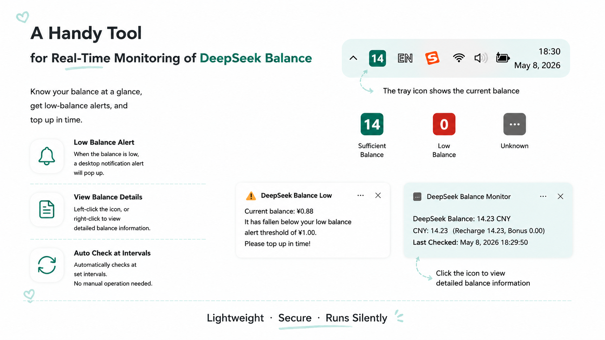
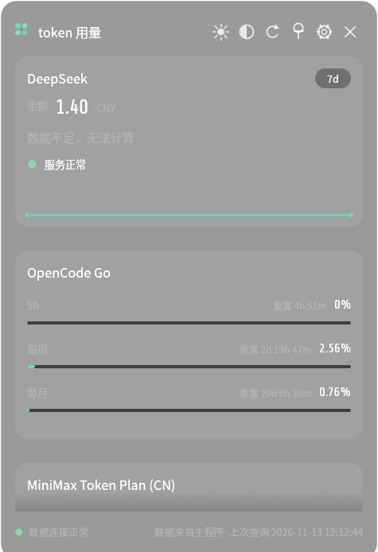

# DeepSeek Balance Monitor

A Windows tray app that periodically queries the DeepSeek API for account balance and alerts on low balance.

[中文版](README_zh.md)





The desktop widget (Rust 2.x `dsmon2-widget`, 2.4.0+) reads this Python build over the local 18964 contract.

[Mac WebView screenshots](assets/webview%20screenshots/) — menu bar, settings UI, history chart, light theme

> **Version note**
>
> - The original Rust 1.x Windows and Linux builds (`rust-windows/`, `rust-linux/`, Plasma 6 widget) are **no longer maintained**; their download and build instructions have been withdrawn.
> - For a Rust build, use **Rust 2.x**: <https://github.com/wenyinos/DeepSeekBalanceMonitor/releases/latest>
> - The Rainmeter desktop widget is **no longer maintained**; use `dsmon2-widget` above for the Windows desktop widget.

---

## Current Version Highlights

- Account usability (Python v2.4.0): an Overview page and a Subscriptions page; each account can carry its own alert line, monthly budget and alert switch; quiet hours silence every notification; a key can be tested before saving and is refused when another account already uses it; a failing account backs off exponentially and its failure episode is announced once; the settings page backs up and restores the data directory.
- The widget contract is v3: `platforms[]` carries `account_id`, `account_name` and each account's own `today_spend`, and an account can be hidden from the panel. The Rust 2.x `dsmon2-widget` reads this build directly.
- DeepSeek service status is parsed from a dual source: the official status page `status.deepseek.com` first, falling back to FlashDuty's backend host; this also fixes a long-standing bug where an outage was never reported (the previous source was FlashDuty's own status page).
- Balance and statistics semantics (Python v2.4.0): negative buckets clamp to 0 and the total is derived from the clamped buckets, so the granted balance is no longer cancelled by a negative top-up; the consumption rate and the estimated-hours figure read the total column and clamp the base at 0.
- Hardening and performance (Python v2.4.0): the local status endpoint is no longer open to browsers, a second launch is refused, an unreadable config is backed up as `config.json.corrupt`, export paths expand `~`/`%VAR%`, quota percentages clamp to 0–100, and the main window no longer stalls on first open.
- Custom icon styling with 5 preset colour themes, custom hex colours, and an icon stroke toggle.
- History viewer with paginated balance records, an interactive trend chart, and consumption rate analysis.
- CSV export with a configurable save path.
- Busy-hour consumption rate estimation (filters idle/flat periods) in balance notifications and the history viewer.
- HTTP proxy support.
- Balance detail notifications now use emoji-prefixed lines and relative last-check time.
- Demo mode for testing without a real API key: developer tools panel on Py-Win/Py-Mac.
- Encrypted API key storage: Fernet + SQLite on Py-Win, Keychain on Py-Mac.
- OpenCode Go / Command Code / GLM / MiniMax quota: add the platform on the Manage page; the dashboard and subscriptions page show 5h / weekly / monthly usage.

## Features

- **Tray icon with balance** — Balance shown as a number on a coloured rounded rectangle. Teal (OK), red (low balance), warm gray (API service degraded), gray (no data yet). 5 customisable themes + custom hex colours.
- **Low balance notification** — Three modes: never, always, or once per drop (default). The icon turns red regardless.
- **Balance details** — Left-click the icon to see balance (emoji-prefixed), consumption rate, API service status, and relative last-check time.
- **History viewer** — Paginated table of all balance records with interactive trend chart and consumption rate analysis. CSV export.
- **Settings** — API key (Fernet + SQLite encrypted storage), check interval, alert threshold, alert mode, icon theme, proxy, and more.
- **OpenCode Go / Command Code / GLM / MiniMax quota** — Add the platform on the Manage page; the dashboard and subscriptions page show 5h/weekly/monthly usage, with encrypted credential storage.
- **Demo mode** — `--demo` flag for testing without an API key, with a developer tools panel.
- **Desktop widget** — Windows uses the Rust 2.x `dsmon2-widget` (see the version note above); Rainmeter is no longer maintained.
- **Community ports** — Py-Mac (Keychain-secured, WebView settings UI).

### Notification Previews

**Normal balance view:**

> DeepSeek Balance:  
> 💰 12.34 CNY (Topped 10.00, Granted 2.34)  
> 📊 Busy: 0.06/hr  |  Est. 28d 4h remaining  
> 📡 DeepSeek API Status: 🟢 All Systems Operational  
> 🕐 Last Check: 5 min ago

**Low balance alert:**

> ⚠ DeepSeek Low Balance  
> Balance is only 0.50, below your alert threshold of 1.00.  
> Please top up!

## Getting Started

### Direct Download

Grab the latest files from [Releases](https://github.com/SrtaEstrella/DeepSeekBalanceMonitor/releases). Python builds use `DeepSeekBalanceMonitor.exe`. Release builds do not require Python.

For a Rust build (Windows / Linux), use **Rust 2.x**: <https://github.com/wenyinos/DeepSeekBalanceMonitor/releases/latest>.

### Desktop Widget (Windows)

The Python build serves the widget contract on `127.0.0.1:18964` (version 3). The Windows desktop widget is a separate program: download `deepseek-balance-monitor-widget-2.4.1-windows-x64.msi` (or the `arm64` package) from <https://github.com/wenyinos/DeepSeekBalanceMonitor/releases/latest>, install it and start `dsmon2-widget`; it reads this build directly.

**Compatibility:** only the 2.4.0 widget (and later) speaks contract v3. The older Rust widget (2.3 and earlier) speaks v2 and refuses a v3 payload, so it cannot be paired with this Python build.

### Requirements

Direct downloads (`.exe`, `.tar.gz`, `.dmg`) require no additional runtimes.

- Py-Win: Windows 10+
- Py-Mac: MacOS 10.14+

Building from source additionally requires Python 3.10+ (Py-Win, Py-Mac).

### Run from Source (Python)

Requires Python 3.10+.

```bash
pip install -r requirements.txt
python main.py
```

### Build from Source

**Python (PyInstaller):**

```bash
pip install pyinstaller
scripts\build_exe.bat
```

Builds `dist\DeepSeekBalanceMonitor.exe`. GitHub Actions auto-builds and attaches the EXE to each release.

**MacOS (`src/mac/`):**

```bash
cd src/mac
pip install -r requirements.txt
bash ../scripts/build_mac.sh
```

### Python builds

| | Python Windows | Python MacOS |
|---|---|---|
| Runtime | Python + pystray + Tkinter | Python + rumps + webview |
| Min OS | Windows 10+ | MacOS 10.14+ |
| First launch (no key) | Opens settings dialog | Opens settings window |
| Auto-start | Registry Run key | Login items |
| API key storage | Fernet + SQLite | MacOS Keychain |

## Project Structure

```
DeepSeekBalance/
├── src/                       # Application package
│   ├── config.py
│   ├── api_client.py
│   ├── icon_renderer.py
│   ├── app_state.py
│   ├── settings_dialog.py
│   ├── tray_app.py
│   ├── credential_store.py
│   ├── secure_settings.py
│   ├── storage.py
│   └── rainmeter_server.py
├── src/mac/                    # Native MacOS port
│   ├── main.py
│   ├── settings.py
│   └── keystore.py
├── scripts/                    # Build & utility scripts
│   ├── build_exe.bat
│   ├── build_mac.sh
│   ├── setup.bat
│   ├── run_silent.vbs
│   └── demo.vbs
├── assets/                     # Icons, previews, fonts
│   ├── app.ico
│   ├── AppIcon.icns / .png
│   ├── preview.png / preview_zh.png
│   └── font/
├── main.py
├── requirements.txt
└── README.md
```

## Configuration

Windows builds store settings in `%APPDATA%\DeepSeek Balance Monitor\config.json`:

```json
{
  "interval_minutes": 10,
  "threshold_yuan": 1.0,
  "language": "zh",
  "alert_mode": "once",
  "api_alert_enabled": true,
  "retention_days": 30,
  "theme": "default",
  "icon_stroke": false,
  "http_proxy": "",
  "auto_start": false
}
```

API keys are never written to this file. Python Windows uses Fernet + SQLite encryption, Python MacOS uses Keychain.

Windows logs are written to `%APPDATA%\DeepSeek Balance Monitor\app.log`.

Balance history is stored in a local SQLite database and uses the same `retention_days` setting as log cleanup. The History page supports days/currency filters, trend summary, chart, and CSV export.

## Tray Menu

| Action | Trigger |
|---|---|
| View Balance | Left-click the icon, or Right-click → View Balance |
| Check Now | Right-click → Check Now |
| Top Up | Right-click → Top Up |
| History | Right-click → History |
| Settings | Right-click → Settings |
| Quit | Right-click → Quit |

## Icon Colours

| Colour | Meaning |
|---|---|
| Teal | Balance is above the alert threshold |
| Red | Balance is below threshold, or an API error occurred |
| Warm gray | API service is degraded (balance data may be stale) |
| Gray | First check not yet completed, or no API key configured |

Colours are customisable via 5 presets or custom hex values in the settings dialog.

## Changelog

[CHANGELOG.md](CHANGELOG.md)

## License

MIT
