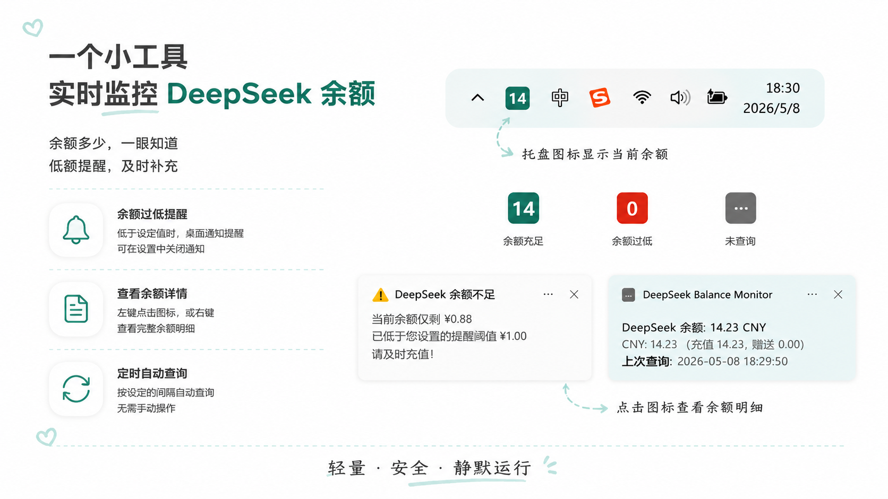
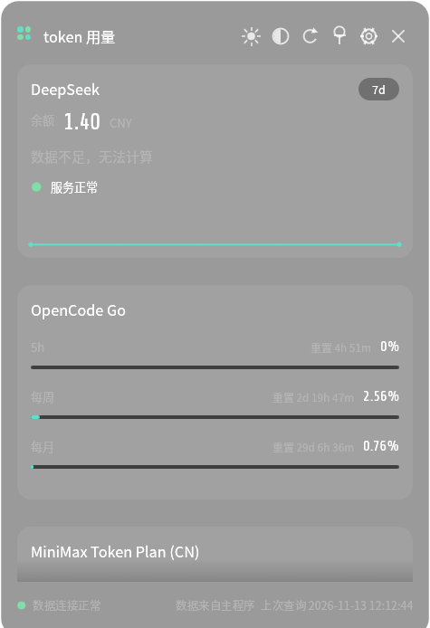

# DeepSeek 余额监控

一个 Windows 系统托盘应用，定时查询 DeepSeek API 账户余额，并在余额过低时提醒。

[English](README.md)





桌面小工具（Rust 2.x `dsmon2-widget`，需 2.4.0+）：通过本机 18964 契约读取 Python 主程序的数据。

[Mac WebView 截图](assets/webview%20screenshots/) — 菜单栏、设置界面、历史图表、浅色主题

> **版本说明**
>
> - 原 Rust 1.x 的 Windows 与 Linux 版本（`rust-windows/`、`rust-linux/`、Plasma 6 小组件）**已停止维护**，相关下载与构建说明已撤下。
> - 需要 Rust 版本请使用 **Rust 2.x**：<https://github.com/wenyinos/DeepSeekBalanceMonitor/releases/latest>
> - Rainmeter 桌面小工具**已停止维护**，不再提供支持；Windows 桌面小工具请用上面的 `dsmon2-widget`。

---

## 当前版本亮点

- 账户化可用性（Python v2.4.0）：新增「概览」与「订阅」页；每个账户可设独立告警线、月预算与告警开关；安静时段内所有通知静默；密钥可在保存前测试，并拒绝重复使用；失败账户按指数退避重试，连续 3 次失败提醒一次；设置页支持一键备份与下次启动恢复。
- 小工具契约升级到 v3：`platforms[]` 带 `account_id`、`account_name` 与每账户自己的 `today_spend`，并可在账户设置里隐藏某个账户。Rust 2.x 的 `dsmon2-widget` 可直接连接本版。
- DeepSeek 服务状态改为双源解析：官方状态页 `status.deepseek.com` 优先，失败回退 FlashDuty 后端主机；并修正了「异常状态永不报告」的问题（旧源实为 FlashDuty 自家状态页）。
- 余额与统计口径（Python v2.4.0）：负的分量按 0 处理、总额由钳后分量重算（赠送余额不再被负充值抵消）；消耗速率与预计可用改读总额列，预计可用基数按 0 钳制。
- 加固与性能（Python v2.4.0）：本地状态接口不再向浏览器开放；重复启动被拒；配置文件无法解析时先备份为 `config.json.corrupt`；导出路径展开 `~`/`%VAR%`；额度百分比钳制到 0–100；首次打开主界面不再卡顿。
- 自定义图标样式：5 套预置配色、自定义 hex 颜色和图标描边开关。
- 历史记录页：分页余额记录、交互式趋势图和消耗速率分析。
- CSV 导出支持配置保存路径。
- 余额通知和历史页显示忙时消耗速率（过滤闲时/平直段）与预计可用时间。
- 支持 HTTP 代理。
- 余额详情通知使用 emoji 前缀和相对上次查询时间。
- Demo 模式无需真实 Key 即可测试：Py-Win/Py-Mac 提供开发者面板。
- API Key 加密存储：Py-Win 使用 Fernet + SQLite，Py-Mac 使用 Keychain。
- OpenCode Go / Command Code / GLM / MiniMax 额度：在「管理」页添加对应平台后，看板与订阅页展示 5h / 每周 / 每月用量。

## 功能

- **托盘图标显示余额** — 余额以数字形式显示在任务栏圆角图标上。青色（正常）、红色（低余额）、暖灰色（API 服务异常）、灰色（无数据）。5 套可切换配色 + 自定义 hex 颜色
- **低余额通知** — 三种模式：不提醒、持续提醒、仅提醒一次（默认）。图标仍会变红
- **余额详情** — 左键单击图标查看余额（emoji 前缀）、消耗速率、API 服务状态和相对时间
- **历史记录页** — 分页表格展示所有余额记录，附带折线图和消耗分析，支持 CSV 导出
- **设置** — API Key（Fernet + SQLite加密存储）、查询间隔、预警阈值、提醒模式、图标主题、代理等
- **OpenCode Go / Command Code / GLM / MiniMax 额度** — 在「管理」页添加对应平台后，看板与订阅页展示 5h/每周/每月用量，凭据加密存储
- **Demo 模式** — `--demo` 免 Key 体验，开发者面板可调参数
- **桌面小工具** — Windows 使用 Rust 2.x 的 `dsmon2-widget`（见上方版本说明）；Rainmeter 已停止维护
- **社区移植** — Py-Mac（Keychain 加密，WebView 设置界面）

### 通知预览

**查看余额：**

> DeepSeek 余额：  
> 💰 12.34 CNY（充值 10.00，赠送 2.34）  
> 📊 忙时消耗 0.06/小时  |  预计可用 28 天 4 小时  
> 📡 DeepSeek API 服务状态：🟢 服务正常  
> 🕐 上次查询：5 分钟前

**低余额告警：**

> ⚠ DeepSeek 余额不足  
> 当前余额仅剩 0.50，已低于您设置的提醒阈值 1.00。  
> 请及时充值！

## 开始使用

### 直接下载

从 [Releases](https://github.com/SrtaEstrella/DeepSeekBalanceMonitor/releases) 下载最新文件。Python 打包版使用 `DeepSeekBalanceMonitor.exe`。发布版无需 Python 环境。

需要 Rust 版本（Windows / Linux）请使用 **Rust 2.x**：<https://github.com/wenyinos/DeepSeekBalanceMonitor/releases/latest>。

### 桌面小工具（Windows）

Python 版在 `127.0.0.1:18964` 提供小工具契约 v3。Windows 桌面小工具是独立程序：到 <https://github.com/wenyinos/DeepSeekBalanceMonitor/releases/latest> 下载 `deepseek-balance-monitor-widget-2.4.1-windows-x64.msi`（ARM64 选 `arm64` 包），安装后启动 `dsmon2-widget`，它会直接读取本版数据。

**兼容性：** 只有 2.4.0 及以上的小工具支持契约 v3；2.3 及以前的 Rust 旧版只认 v2，会拒绝 v3 载荷，不能与本 Python 版搭配。

### 运行要求

直接下载（`.exe`、`.dmg`）无需额外运行环境。

- Py-Win：Windows 10+
- Py-Mac：MacOS 10.14+

从源码运行或构建需要 Python 3.10+（Py-Win、Py-Mac）。

### 源码运行（Python）

需要 Python 3.10+。

```bash
pip install -r requirements.txt
python main.py
```

### 从源码构建

**Python（PyInstaller）：**

```bash
pip install pyinstaller
scripts\build_exe.bat
```

构建为 `dist\DeepSeekBalanceMonitor.exe`。GitHub Actions 会在每次 Release 时自动构建并上传 EXE。

**MacOS（`src/mac/`）：**

```bash
cd src/mac
pip install -r requirements.txt
bash ../scripts/build_mac.sh
```

### Python 版对比

| | Python Windows 版 | Python MacOS 版 |
|---|---|---|
| 运行时 | Python + pystray + Tkinter | Python + rumps + webview |
| 最低系统 | Windows 10+ | MacOS 10.14+ |
| 首次无 Key | 弹出设置窗口 | 弹出设置窗口 |
| 开机自启 | 注册表 Run 键 | 登录项 |
| API Key 存储 | Fernet + SQLite | MacOS Keychain |

## 项目结构

```
DeepSeekBalance/
├── src/                       # 应用主包
│   ├── config.py
│   ├── api_client.py
│   ├── icon_renderer.py
│   ├── app_state.py
│   ├── settings_dialog.py
│   ├── tray_app.py
│   ├── credential_store.py
│   ├── secure_settings.py
│   ├── storage.py
│   └── rainmeter_server.py
├── src/mac/                    # 原生 MacOS 移植
│   ├── main.py
│   ├── settings.py
│   └── keystore.py
├── scripts/                    # 构建与工具脚本
│   ├── build_exe.bat
│   ├── build_mac.sh
│   ├── setup.bat
│   ├── run_silent.vbs
│   └── demo.vbs
├── assets/                     # 图标、预览图、字体
│   ├── app.ico
│   ├── AppIcon.icns / .png
│   ├── preview.png / preview_zh.png
│   └── font/
├── main.py
├── requirements.txt
└── README.md
```

## 配置

Windows 配置文件路径：`%APPDATA%\DeepSeek Balance Monitor\config.json`

```json
{
  "interval_minutes": 10,
  "threshold_yuan": 1.0,
  "language": "zh",
  "alert_mode": "once",
  "api_alert_enabled": true,
  "retention_days": 30,
  "theme": "default",
  "icon_stroke": false,
  "http_proxy": "",
  "auto_start": false
}
```

API Key 不写入此文件。Python Windows 使用 Fernet + SQLite 加密，Python MacOS 使用 Keychain。

Windows 日志路径：`%APPDATA%\DeepSeek Balance Monitor\app.log`

历史记录保存在本地 SQLite，使用与日志清理相同的 `retention_days` 保留天数。历史页支持天数 / 币种筛选、趋势统计、图表和 CSV 导出。

## 托盘菜单

| 操作 | 方式 |
|---|---|
| 查看余额 | 左键单击图标，或右键 → 查看余额 |
| 立即查询 | 右键 → 立即查询 |
| 充值 | 右键 → 充值 |
| 历史记录 | 右键 → 历史记录 |
| 设置 | 右键 → 设置 |
| 退出 | 右键 → 退出 |

## 图标颜色

| 颜色 | 含义 |
|---|---|
| 青色 | 余额高于预警阈值 |
| 红色 | 余额低于阈值，或 API 查询出错 |
| 暖灰 | API 服务异常（余额数据可能已过时） |
| 灰色 | 尚未完成首次查询，或未配置 Key |

配色支持 5 套预设或自定义 hex 值，在设置中切换。

## 更新日志

[CHANGELOG_zh.md](CHANGELOG_zh.md)

## 协议

MIT
